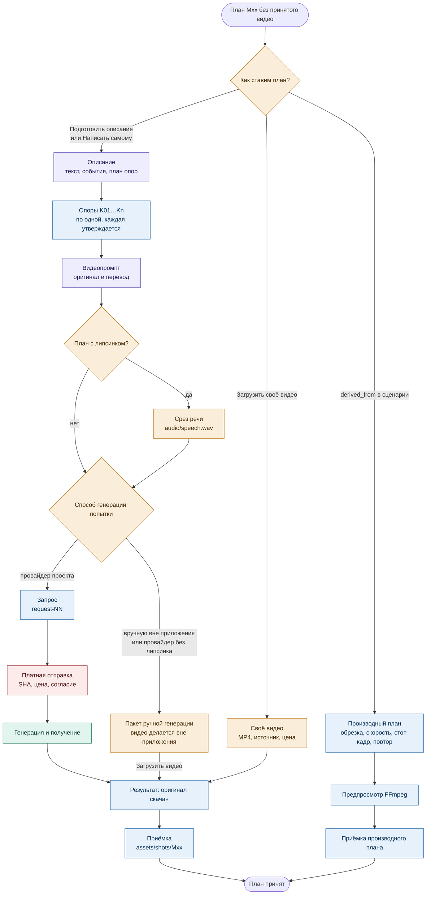
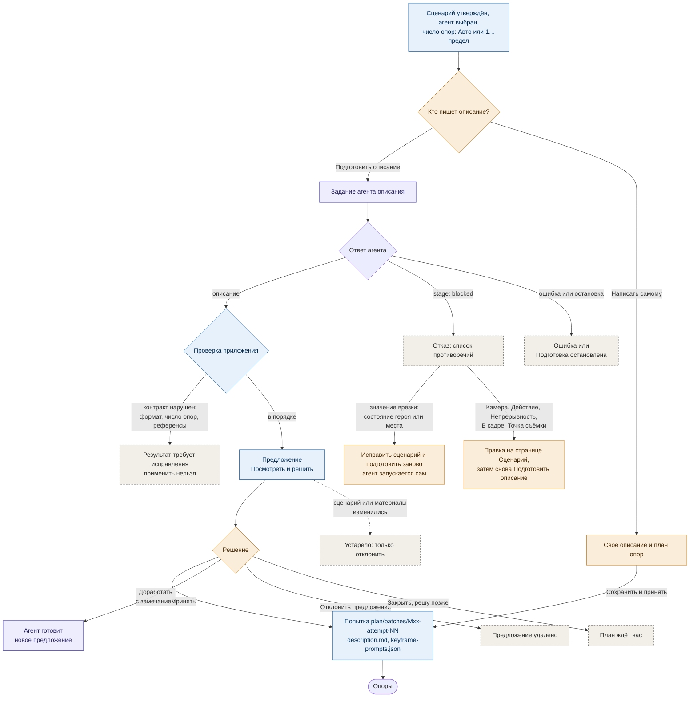
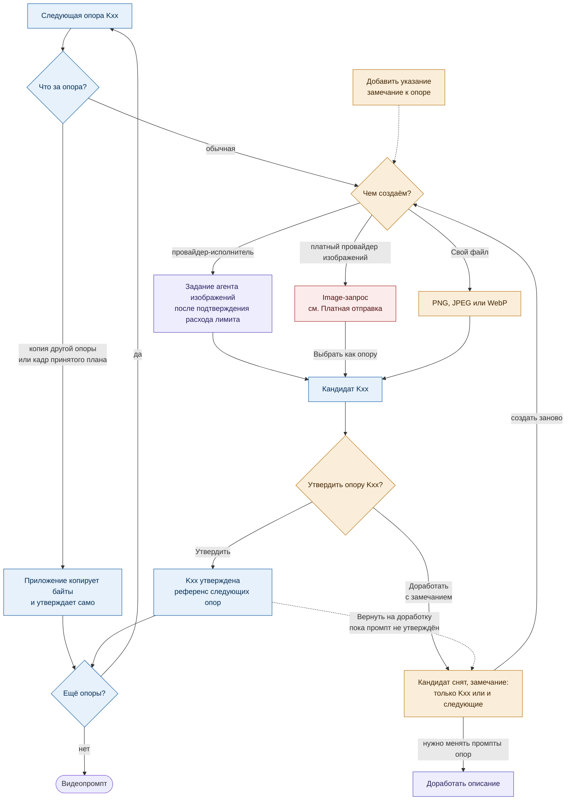
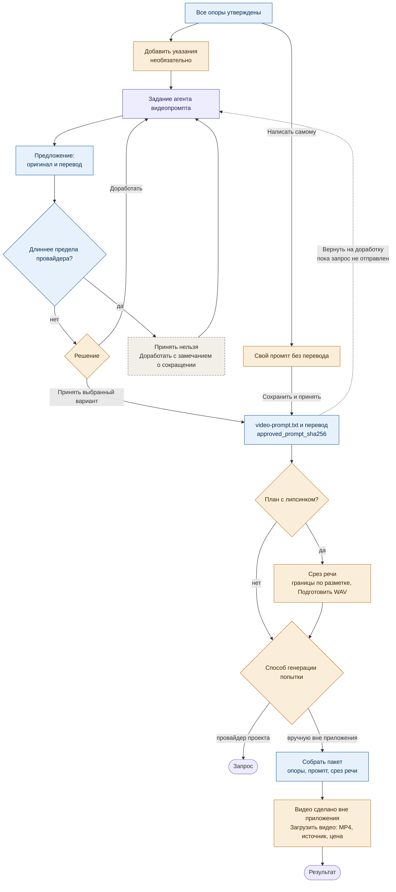
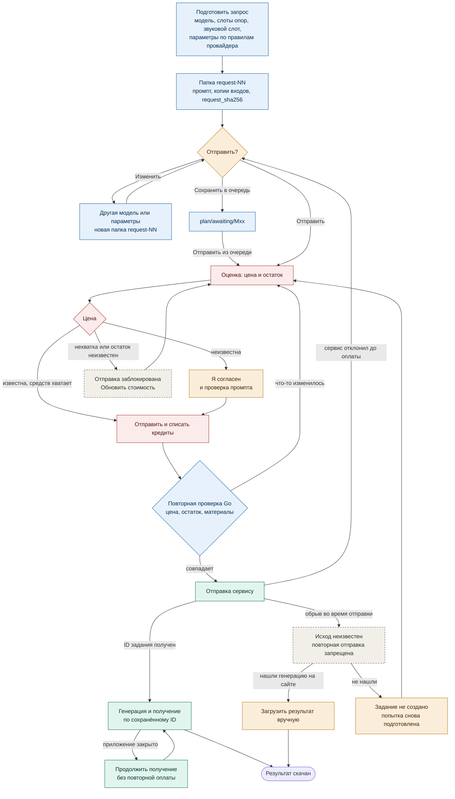
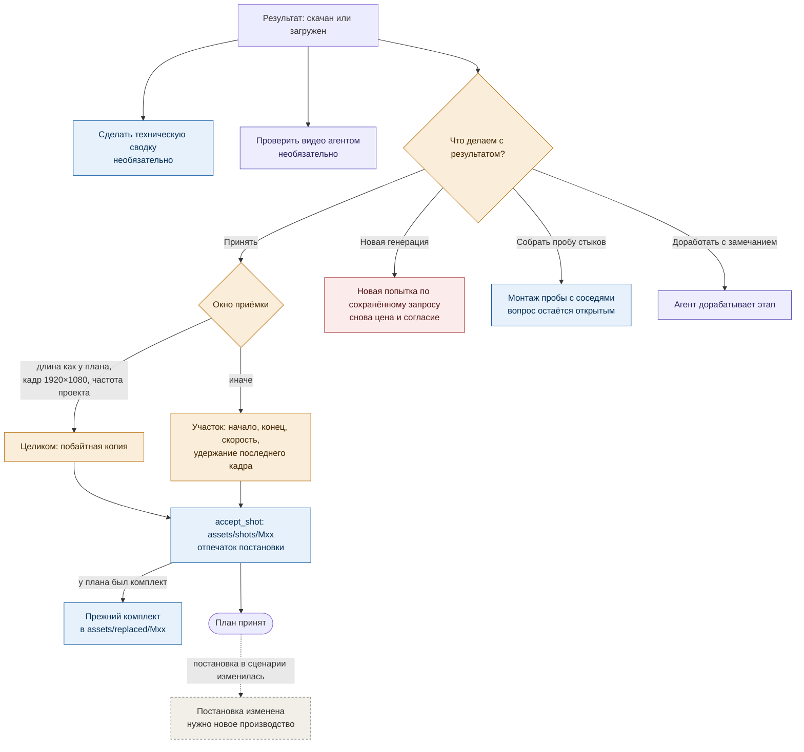
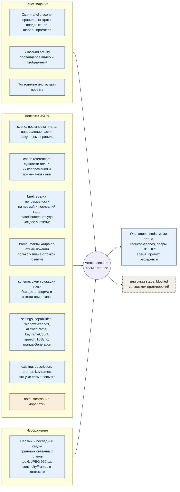
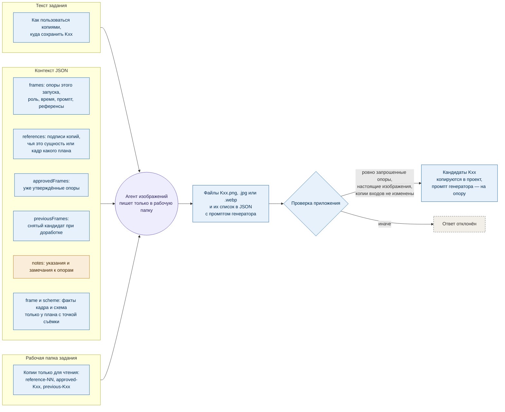
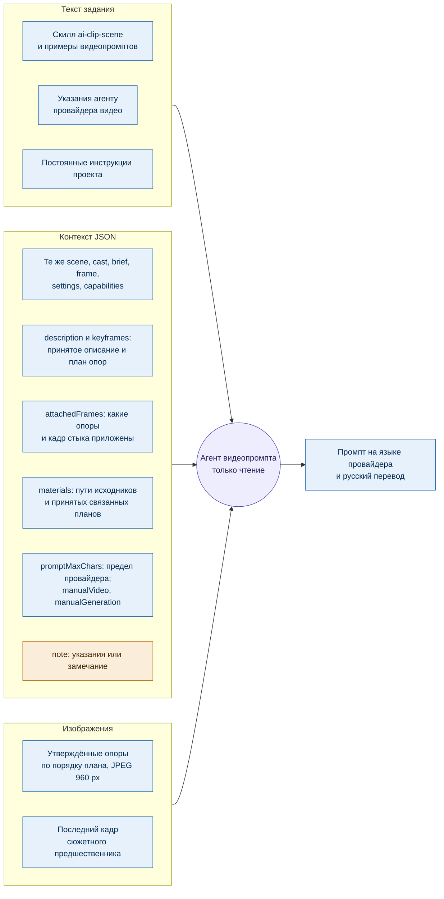
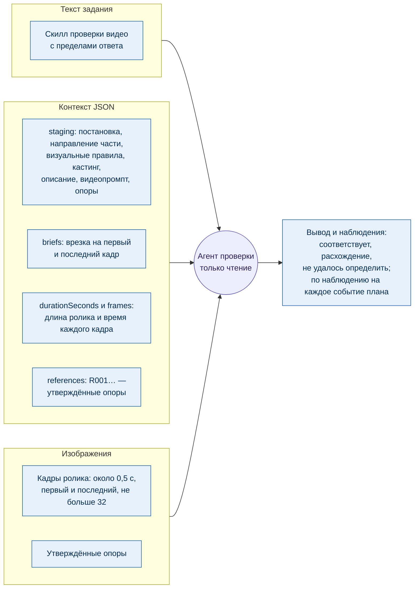

# Карта производства

Схемы пути плана на странице «Производство»: все ветки от сценария до принятого видео и то, что на каждом этапе получает агент. Правила, проверки и контракт описаны в [production-workflow.md](production-workflow.md); схемы их не заменяют, а показывают, как шаги связаны.

Цвета на схемах:

| Цвет | Кто действует |
| --- | --- |
| жёлтый | пользователь: решение, свой файл или текст |
| фиолетовый | текстовый агент или агент изображений |
| синий | приложение само, без агента и сети |
| красный | платная операция: цена, согласие, списание |
| зелёный | сервис генерации |
| серый пунктир | тупик или возврат: отказ, ошибка, устаревание |

## Весь путь плана

Три способа поставить план: обычное производство, своё готовое видео или производный план из уже принятого клипа. Речевой план добавляет срез речи; без липсинка у провайдера видео он идёт ручной генерацией.

## Описание

Перед подготовкой выбирается число опор: «Авто» (агент берёт от 2 до 20) или точное число до предела провайдера видео. Агент работает только на чтение и отвечает одним JSON: предложением или отказом со списком противоречий. Отказ — нормальный исход: сценарий спорит с фактами кадра, кадрами соседних планов или сам с собой, и опоры по нему вышли бы неверными.

Доработка оплаченной попытки создаёт новую попытку с `retry_of`: утверждённые опоры с неизменными файлами переносятся в неё утверждёнными.

## Опоры

Опоры идут строго по порядку плана: следующая создаётся, когда решено с предыдущей. Утверждённые опоры становятся референсами следующих, поэтому внешность, свет и расстановка держатся от K01 до последней.

Опору, которую уже не вернуть на месте (запрос подготовлен или отправлен), исправляют в «Новой попытке с теми же опорами».

## Видеопромпт и способ генерации

Агент пишет промпт на языке указаний провайдера видео и рядом русский перевод. К отправке выбирается один из вариантов; предел длины провайдера относится к нему.

## Запрос и платная отправка

Запрос собирает приложение без агента. Схема показывает запрос видео; платная опора проходит те же оценку, согласие, отправку и получение по одному image-запросу, а скачанный вариант выбирается кандидатом опоры. Каждая отправка записывается в журнал отправок до того, как уходит к сервису.

Согласие действует на одну показанную оценку: «Обновить стоимость», смена запроса, «Ещё» или повтор после ошибки требуют нового.

## Результат, приёмка и повтор

Меню «Другие действия» плана начинает попытку заново с нужного места:

| Действие | С чего начинается новая попытка |
| --- | --- |
| Новая попытка с описания | с шага «Описание» |
| Новая попытка с теми же опорами | с шага «Видеопромпт»: описание и утверждённые опоры переносятся |
| Новая попытка только с первой опорой | с шага «Видеопромпт»: описание и первая опора переносятся, промпт пишется для одной опоры |
| Повторить по сохранённому запросу | с вопроса об отправке того же запроса |
| Удалить попытку | попытка удаляется целиком, оплаченный оригинал тоже |

## Что получает агент

Агента запускает приложение без shell ([agents.md](agents.md)). Задания описания, видеопромпта и проверки видео только читают проект: агент не может ничего записать и отвечает одним JSON. Задание опор пишет только в свою рабочую папку вне проекта. Текст задания складывается из общего вступления, постоянных инструкций проекта (кроме заданий изображений), встроенного скилла с задачей и контекста JSON. Изображения идут отдельными вложениями в пределах [бюджета агента](agent-image-limits.md). Каждое задание записывается в журнал отправок `plan/prompt-log/` целиком: промпт, контекст, вложения путями и SHA, ответ.

Ответ агента не пишется в проект напрямую: приложение проверяет его по контракту. Описание и видеопромпт применяются только после решения пользователя, а файлы опор становятся кандидатами, которые пользователь утверждает.

### Описание

Приложение принимает описание, только если опоры идут подряд от `K01`, первая стоит в 0, последняя на границе запроса, число опор совпадает с выбранным, длительность подходит провайдеру, а референсы взяты из `allowedPaths`. Иначе предложение получает статус «Результат требует исправления».

### Опоры у провайдера-исполнителя

Платная опора агента не использует: промпт опоры из описания, замечания к опорам и подписи слотов утверждённых опор приложение собирает в image-запрос само. Входы — референсы описания, за ними утверждённые опоры плана.

### Видеопромпт

Предел длины проверяется при утверждении: промпт длиннее предела нельзя принять, только доработать.

### Проверка видео

Отчёт с кадром, которого не было в выборке, или временем вне ролика отклоняется целиком. Проверка ничего не решает за пользователя: принять, доработать или повторить — его ответ на вопрос о результате.
