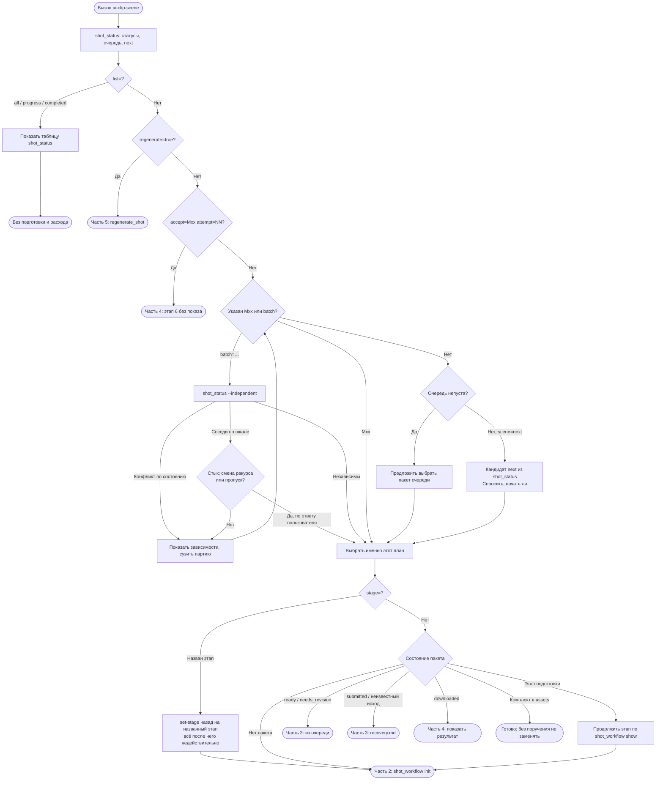
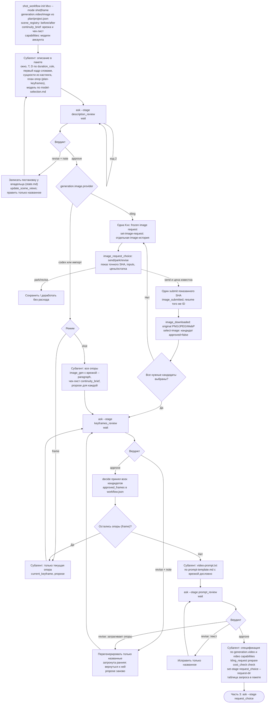
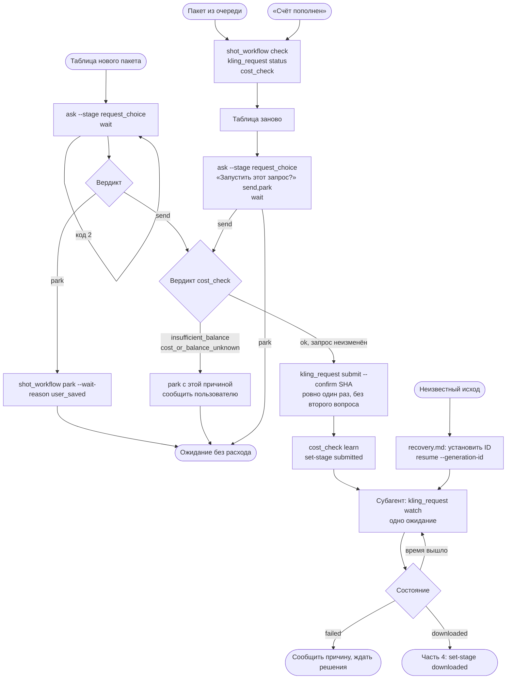
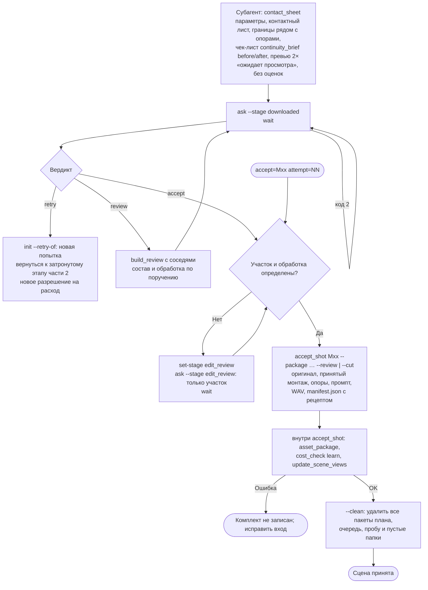
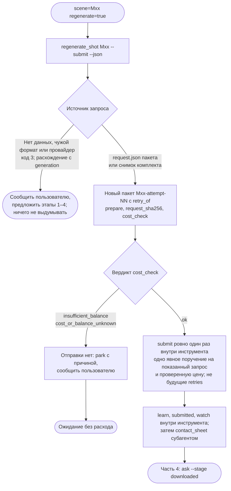

# Диаграммы процесса ai-clip-scene

Наглядное представление [скилла](SKILL.md) в пяти частях; в узлах указаны инструменты. Правила и условия переходов определяет скилл; диаграммы обновляются вместе с ним.

Узлы согласования работают через `workflow.json` пакета: основной поток пишет вопрос командой `shot_workflow ask --stage …`, блокируется в `shot_workflow wait`, а приложение по кнопке пользователя записывает ответ командой `shot_workflow decide --verdict …`. Переход по стрелке разрешает только полученный вердикт (`wait` с кодом 0); код 2 (время вышло) и код 3 (пакет изменён снаружи) перехода не дают. Подготовку материалов внутри узлов выполняет субагент, в чат возвращается карточка. Без приложения вопрос задаётся текстом с теми же вариантами, и ответ записывается через `decide` агентом. Полные правила в разделах [«Согласования в приложении»](SKILL.md#согласования-в-приложении) и [«Субагенты»](SKILL.md#субагенты).

## 1. Вызов и выбор плана

## 2. Подготовка и согласование

Выбор кандидата изображения не утверждает опору и не принимает assets. Текстовый агент и глобальный Codex `imageAgent` независимы от backend медиа; `app|agent` остаётся единственным владельцем продолжения.

В партии этапы описания, опор и промпта проходят по одному раунду на всех планах сразу (`--batch` в `shot_workflow init`): субагент готовит все пакеты, `ask` ставится в каждом пакете, `wait` выполняется по очереди. Таблицы и отправки остаются поплановыми, ожидание общее через `watch`.

## 3. Отправка, очередь, получение

## 4. Результат, проба, приёмка

## 5. Повтор запроса: `regenerate=true`

Пересборка полного аниматика, commit и push выполняются по отдельному поручению.
