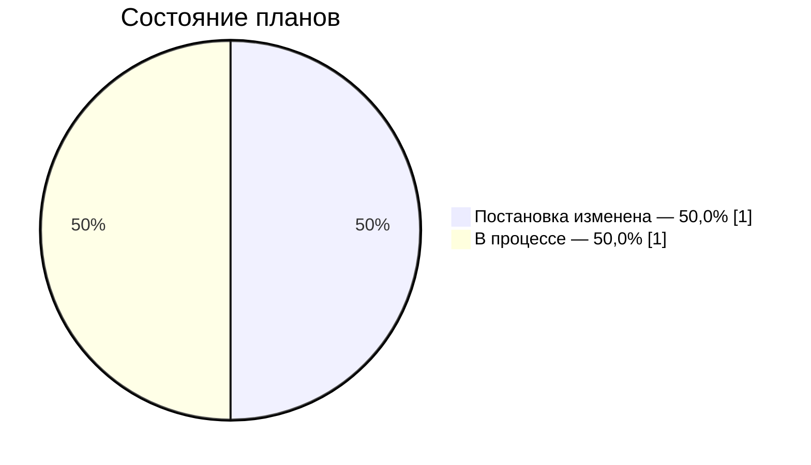

# ROADMAP — состояние клипа «Тестовый клип»

> Автоматическое представление plan/scenes.json, локальных ассетов и состояния работ. Вручную не редактировать.

Всего 2 планов; готовы 0. [Текущий полный монтаж](plan/animatic/latest/README.md). Сборка устарела относительно исходников; требуется пересборка.

## Готовность проекта

| Состояние | Планов | Доля от общего числа |
| --- | ---: | ---: |
| Готово | 0 | 0,0% |
| Постановка изменена | 1 | 50,0% |
| В процессе | 1 | 50,0% |
| Запланировано | 0 | 0,0% |

**По хронометражу готово 0,0%** — 00:00.0 из 00:00.8.
Доли по планам считаются по их количеству, по хронометражу — по кадровым границам. Готов план, выбранный комплект которого в assets принят по текущей постановке; после её правки план требует нового производства.

## Планы

| План | Тайминг | Действие | Состояние | Материалы | В полном монтаже |
| --- | --- | --- | --- | --- | --- |
| **M01** | 00:00.0–00:00.4 · 0.4 с | Технический кадр | **Постановка изменена** | [Постановка](plan/storyboard.md#m01) · [Манифест](assets/shots/M01/manifest.json) · [Видео](assets/shots/M01/accepted-edit.mp4) | Устаревшая сборка |
| **M02** | 00:00.4–00:00.8 · 0.4 с | Технический кадр | **В процессе** | [Постановка](plan/storyboard.md#m02) | Устаревшая сборка |

Изменять постановку и монтажные границы только в [реестре сцен](plan/scenes.json). [Сценарий](source/description.md) описывает общую историю. Генерации и обработка сохраняются в локальных манифестах assets. Незавершённая работа — в рабочих пакетах `plan/batches` и `plan/awaiting` (страница «Производство»).

Представления обновляет приложение: кнопка «Пересобрать карточки» в строке «Карточки и списки» на странице «Проверки»; проверка той же строки находит рассинхрон.
