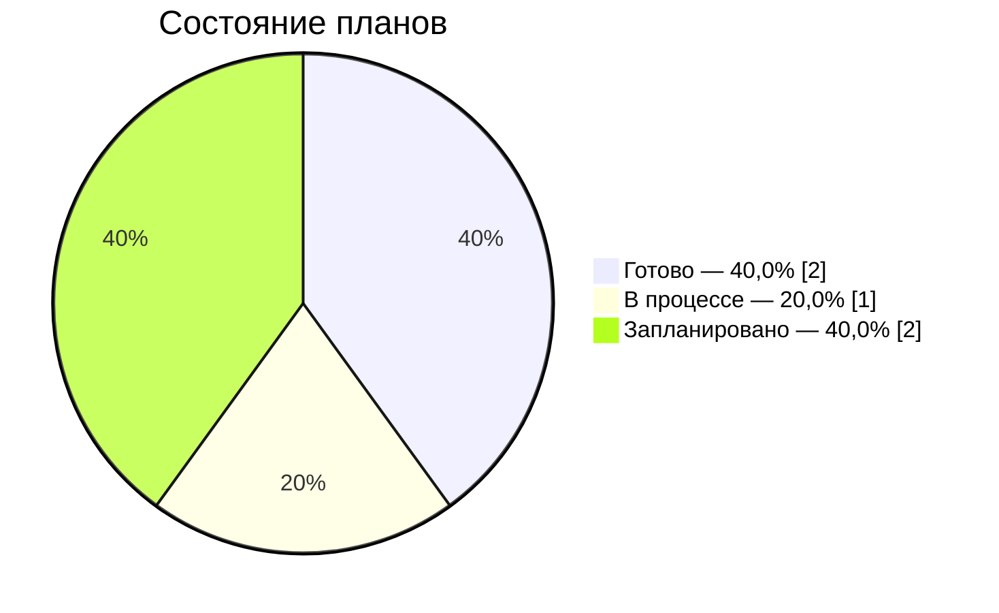

# ROADMAP — состояние клипа «Пробный клип»

> Автоматическое представление plan/scenes.json, локальных ассетов и состояния работ. Вручную не редактировать.

Всего 5 планов; готовы 2. [Текущий полный монтаж](plan/animatic/latest/README.md). Полная сборка ожидает просмотра.

## Готовность проекта

| Состояние | Планов | Доля от общего числа |
| --- | ---: | ---: |
| Готово | 2 | 40,0% |
| В процессе | 1 | 20,0% |
| Запланировано | 2 | 40,0% |

**По хронометражу готово 40,0%** — 00:12.0 из 00:30.0.
Доли по планам считаются по их количеству, по хронометражу — по кадровым границам. Готов план, выбранный комплект которого в assets принят по текущей постановке; после её правки план требует нового производства.

## Планы

| План | Тайминг | Действие | Состояние | Материалы | В полном монтаже |
| --- | --- | --- | --- | --- | --- |
| **M01** | 00:00.0–00:08.0 · 8 с | Лодка покачивается у причала. | **Готово** | [Постановка](plan/storyboard.md#m01) · [Манифест](assets/shots/M01/manifest.json) · [Видео](assets/shots/M01/video.mp4) | Видео |
| **M02** | 00:08.0–00:12.0 · 4 с | Мира держит фонарик, Лев смотрит на воду. | **Готово** | [Постановка](plan/storyboard.md#m02) · [Манифест](assets/shots/M02/manifest.json) · [Видео](assets/shots/M02/video.mp4) | Видео |
| **M03** | 00:12.0–00:16.0 · 4 с | Фонарики качаются на ветру. | **В процессе** | [Постановка](plan/storyboard.md#m03) | Карточка |
| **M04** | 00:16.0–00:20.0 · 4 с | Мира поднимает фонарик, Лев улыбается. | **Запланировано** | [Постановка](plan/storyboard.md#m04) | Карточка |
| **M05** · из M02 | 00:20.0–00:30.0 · 10 с | Повтор кадра у воды как финальная точка. | **Запланировано** | [Постановка](plan/storyboard.md#m05) | Карточка |

Изменять постановку и монтажные границы только в [реестре сцен](plan/scenes.json). [Сценарий](source/description.md) описывает общую историю. Генерации и обработка сохраняются в локальных манифестах assets. Незавершённая работа — в рабочих пакетах `plan/batches` и `plan/awaiting` (страница «Производство»).

Представления обновляет приложение: кнопка «Пересобрать карточки» в строке «Карточки и списки» на странице «Проверки»; проверка той же строки находит рассинхрон.
